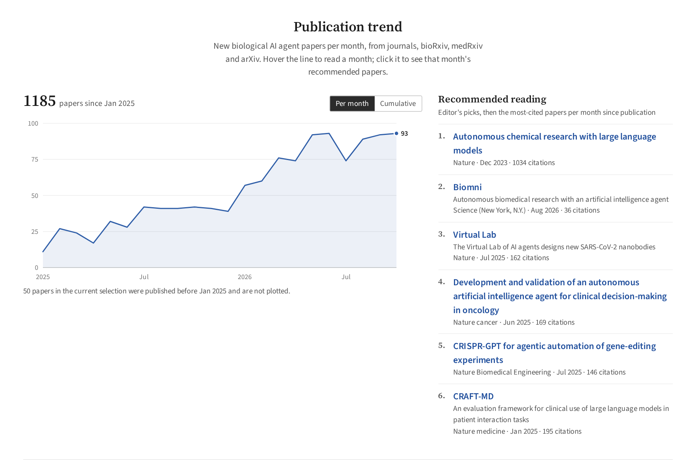
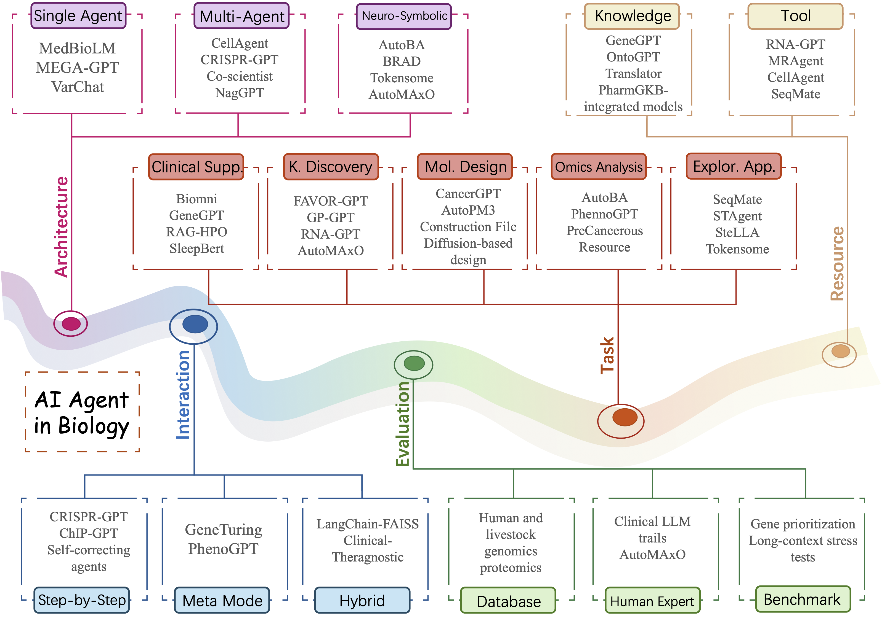

# AI Agents in Biology

<p align="center">
  <a href="https://mineself2016.github.io/biological_agents_survey/"></a>
</p>
<p align="center">
  <b><a href="https://mineself2016.github.io/biological_agents_survey/">Open the project page →</a></b><br>
  <sub>Filter all 1370 papers by the five taxonomy dimensions, follow the monthly trend, and find recommended reading.</sub>
</p>

[](#all-papers)
[](#latest-papers)
[](https://mineself2016.github.io/biological_agents_survey/)

Companion resource for

> **[Artificial Intelligence agents for biological research: a survey](https://academic.oup.com/bib/article/27/1/bbag075/8499367)**
> Cong Qi\*, Wenbo Wang\*, Siqi Jiang, Qin Liu, Xun Song, Hanzhang Fang, Zhi Wei.
> *Briefings in Bioinformatics* 27(1), bbag075 (2026).

A curated, weekly updated list of LLM-driven AI agents for biological and biomedical research,
from journals, bioRxiv, medRxiv and arXiv. Every paper is tagged on the survey's five dimensions:
biological task, system architecture, interaction mode, evaluation strategy and resource integration.
**[Browse it on the project page](https://mineself2016.github.io/biological_agents_survey/)** to filter by any combination of tags and see
how the field grows month by month.



## Recommended reading

Most-cited papers per month since publication (citation counts from OpenAlex).

- **Biomni**: [Autonomous biomedical research with an artificial intelligence agent](https://doi.org/10.1126/science.adz4351) · Aug 2026 · *Science (New York, N.Y.)* `Knowledge discovery & hypothesis generation` `Multi-omics analysis` `Molecular & drug design` `Exploratory applications` `Single-agent` `Step-by-step` `Automated, model-centric` `Knowledge-augmented` `Tool-augmented` · 364 citations
- [Autonomous chemical research with large language models](https://www.nature.com/articles/s41586-023-06792-0) † · Dec 2023 · *Nature* `Molecular & drug design` `Multi-agent` `Step-by-step` `Automated, model-centric` `Tool-augmented` `Knowledge-augmented` · 2738 citations
- **Co-Scientist**: [Accelerating scientific discovery with Co-Scientist](https://arxiv.org/abs/2502.18864) · Feb 2025 · *arXiv* `Knowledge discovery & hypothesis generation` `Molecular & drug design` `Multi-agent` `Step-by-step` `Automated, model-centric` `Human-in-the-loop` `Knowledge-augmented` · 1211 citations
- **AgentClinic**: [AgentClinic: a multimodal benchmark for tool-using clinical AI agents](https://doi.org/10.1038/s41746-026-02674-7) · Apr 2026 · *NPJ digital medicine* `Clinical decision support` `Single-agent` `Step-by-step` `Human-in-the-loop` `Automated, model-centric` `Knowledge-augmented` `Tool-augmented` · 419 citations
- **Virtual Lab**: [The Virtual Lab of AI agents designs new SARS-CoV-2 nanobodies](https://doi.org/10.1038/s41586-025-09442-9) · Jul 2025 · *Nature* `Molecular & drug design` `Multi-agent` `Step-by-step` `Automated, model-centric` `Human-in-the-loop` `Tool-augmented` · 587 citations
- **DeepRare**: [An agentic system for rare disease diagnosis with traceable reasoning](https://doi.org/10.1038/s41586-025-10097-9) · Feb 2026 · *Nature* `Clinical decision support` `Multi-agent` `Step-by-step` `Automated, model-centric` `Human-in-the-loop` `Knowledge-augmented` `Tool-augmented` · 203 citations
- [CRISPR-GPT for agentic automation of gene-editing experiments](https://www.nature.com/articles/s41551-025-01463-z) † · Jul 2025 · *Nature Biomedical Engineering* `Knowledge discovery & hypothesis generation` `Molecular & drug design` `Multi-agent` `Step-by-step` `Hybrid` `Automated, model-centric` `Human-in-the-loop` `Tool-augmented` `Knowledge-augmented` · 336 citations
- [Development and validation of an autonomous artificial intelligence agent for clinical decision-making in oncology](https://doi.org/10.1038/s43018-025-00991-6) · Jun 2025 · *Nature cancer* `Clinical decision support` `Single-agent` `Step-by-step` `Automated, model-centric` `Human-in-the-loop` `Knowledge-augmented` `Tool-augmented` · 326 citations
- **CRAFT-MD**: [An evaluation framework for clinical use of large language models in patient interaction tasks](https://doi.org/10.1038/s41591-024-03328-5) · Jan 2025 · *Nature medicine* `Clinical decision support` `Step-by-step` `Zero-shot planner` `Automated, model-centric` `Human-in-the-loop` `Knowledge-augmented` `Tool-augmented` · 398 citations
- **MIRA**: [Towards autonomous medical artificial intelligence agents](https://doi.org/10.1038/s41586-026-10675-5) · Jun 2026 · *Nature* `Clinical decision support` `Single-agent` `Step-by-step` `Automated, model-centric` `Human-in-the-loop` `Tool-augmented` · 86 citations
- **MedicalAgentsBench**: [MedicalAgentsBench for complex medical reasoning: Comparing internalized reasoning models versus externalized agent-based frameworks](https://doi.org/10.1016/j.patter.2026.101610) · Jul 2026 · *Patterns (New York, N.Y.)* `Clinical decision support` `Knowledge discovery & hypothesis generation` `Single-agent` `Multi-agent` `Hybrid` `Automated, model-centric` `Knowledge-augmented` `Tool-augmented` · 70 citations
- **openCHA**: [Conversational health agents: a personalized large language model-powered agent framework](https://doi.org/10.1093/jamiaopen/ooaf067) · Jul 2025 · *JAMIA open* `Clinical decision support` `Knowledge discovery & hypothesis generation` `Single-agent` `Step-by-step` `Automated, model-centric` `Knowledge-augmented` `Tool-augmented` · 231 citations
- **AMIE**: [Towards conversational artificial intelligence for disease management](https://doi.org/10.1038/s41586-026-10764-5) · Jun 2026 · *Nature* `Clinical decision support` `Multi-agent` `Step-by-step` `Human-in-the-loop` `Knowledge-augmented` · 76 citations
- **MAC**: [Enhancing diagnostic capability with multi-agents conversational large language models](https://doi.org/10.1038/s41746-025-01550-0) · Mar 2025 · *NPJ digital medicine* `Clinical decision support` `Multi-agent` `Step-by-step` `Automated, model-centric` `Human-in-the-loop` `Knowledge-augmented` · 250 citations
- [Leveraging Large Language Models for Decision Support in Personalized Oncology](https://jamanetwork.com/journals/jamanetworkopen/fullarticle/2812097#google_vignette) † · Nov 2023 · *JAMA Network Open* `Clinical decision support` `Single-agent` `Zero-shot planner` `Human-in-the-loop` · 415 citations

## Latest papers

- **GinsengMind**: [GinsengMind: An evidence-grounded AI research agent for integrative molecular research in Panax ginseng](https://doi.org/10.64898/2026.11.22.768453) · Nov 2026 · *bioRxiv* `Knowledge discovery & hypothesis generation` `Molecular & drug design` `Single-agent` `Step-by-step` `Human-in-the-loop` `Knowledge-augmented`
- **Multiagent LLM Framework**: [A Multiagent Large Language Model Framework for Longitudinal Multimodal Tracking of Wet Age-Related Macular Degeneration: Retrospective Feasibility Study](https://doi.org/10.2196/106685) · Nov 2026 · *JMIR formative research* `Clinical decision support` `Knowledge discovery & hypothesis generation` `Multi-agent` `Step-by-step` `Human-in-the-loop` `Knowledge-augmented`
- [What Does an Agent-Run Clinic Cost? Protocol for a Prospective Observational Study of the Compute Cost of Completed Work in a Clinical Agent Fleet](https://doi.org/10.64898/2026.11.19.26368538) · Nov 2026 · *medRxiv* `Clinical decision support` `Multi-agent` `Human-in-the-loop` `Knowledge-augmented` `Tool-augmented`
- **MedUIGym**: [MedUIGym: Evaluating and Training GUI Agents for Clinical Workflows](https://arxiv.org/abs/2611.30983) · Nov 2026 · *arXiv* `Clinical decision support` `Single-agent` `Step-by-step` `Automated, model-centric` `Human-in-the-loop` `Knowledge-augmented` `Tool-augmented`
- **WARD**: [Seeing Is Not Acting: WARD Diagnoses the Evidence-to-State-to-Action Gap in Longitudinal Clinical Agents](https://arxiv.org/abs/2611.29243) · Nov 2026 · *arXiv* `Clinical decision support` `Single-agent` `Step-by-step` `Automated, model-centric` `Human-in-the-loop` `Knowledge-augmented` `Tool-augmented`
- **MicroBioAgent**: [MicroBioAgent: an AI agent for automated microbiome analysis](https://doi.org/10.64898/2026.11.17.767465) · Nov 2026 · *bioRxiv* `Knowledge discovery & hypothesis generation` `Multi-omics analysis` `Single-agent` `Step-by-step` `Automated, model-centric` `Knowledge-augmented` `Tool-augmented`
- **Semantic PID-RSI**: [Improving the Improver: Semantic PID Control for Medical Agent Self-Improvement](https://arxiv.org/abs/2611.28680) · Nov 2026 · *arXiv* `Clinical decision support` `Multi-agent` `Neuro-symbolic` `Step-by-step` `Automated, model-centric` `Knowledge-augmented` `Tool-augmented`
- **LesionAgent**: [LesionAgent: Training-Free Agentic Tumor Tracking and Response Assessment in Longitudinal CT](https://arxiv.org/abs/2611.27876) · Nov 2026 · *arXiv* `Clinical decision support` `Knowledge discovery & hypothesis generation` `Single-agent` `Step-by-step` `Human-in-the-loop` `Knowledge-augmented` `Tool-augmented`
- **ClinDataBench**: [ClinDataBench: Benchmarking Large Language Model Agents in Clinical Trial Analysis Dataset Construction](https://doi.org/10.64898/2026.11.17.26368316) · Nov 2026 · *medRxiv* `Clinical decision support` `Knowledge discovery & hypothesis generation` `Single-agent` `Step-by-step` `Automated, model-centric` `Knowledge-augmented`
- **MedicalRSI**: [MedicalRSI: Medical Recursive Self-Improving Agents via Clinical Model-Harness Co-Evolution](https://arxiv.org/abs/2611.26806) · Nov 2026 · *arXiv* `Clinical decision support` `Single-agent` `Neuro-symbolic` `Step-by-step` `Automated, model-centric` `Knowledge-augmented` `Tool-augmented`
- **StoiAgent**: [Accurate and interpretable protein complex stoichiometry prediction through agentic AI with StoiAgent](https://doi.org/10.64898/2026.11.17.767325) · Nov 2026 · *bioRxiv* `Knowledge discovery & hypothesis generation` `Exploratory applications` `Single-agent` `Step-by-step` `Automated, model-centric` `Knowledge-augmented` `Tool-augmented`
- **Dr. CaBot**: [Agentic AI versus pediatric emergency physicians for differential diagnosis of acutely ill and injured children](https://doi.org/10.64898/2026.11.16.26367440) · Nov 2026 · *medRxiv* `Clinical decision support` `Single-agent` `Neuro-symbolic` `Step-by-step` `Human-in-the-loop` `Knowledge-augmented`
- **SPIDER**: [SPIDER: Contextualizing Biomedical Knowledge for Evidence-Grounded Scientific Reasoning](https://doi.org/10.64898/2026.11.11.765839) · Nov 2026 · *bioRxiv* `Knowledge discovery & hypothesis generation` `Exploratory applications` `Multi-agent` `Hybrid` `Human-in-the-loop` `Knowledge-augmented`
- **ARIPA**: [ARIPA: Agentic Reasoning for Image-based Pathology Analysis](https://doi.org/10.64898/2026.11.16.767159) · Nov 2026 · *bioRxiv* `Clinical decision support` `Knowledge discovery & hypothesis generation` `Single-agent` `Step-by-step` `Automated, model-centric` `Human-in-the-loop` `Knowledge-augmented` `Tool-augmented`
- **Dingent**: [Dingent: A Configurable Agent Framework for Biological Database Retrieval and Integration](https://doi.org/10.34133/csbj.0282) · Nov 2026 · *Computational and structural biotechnology journal* `Knowledge discovery & hypothesis generation` `Single-agent` `Multi-agent` `Step-by-step` `Automated, model-centric` `Knowledge-augmented` `Tool-augmented`
- **BiomedCAT**: [BiomedCAT: Biomedical Context Analysis Tool for Supporting Mechanistic Hypothesis Generation via User-defined Contextual Subgraph Extraction](https://doi.org/10.64898/2026.11.11.766070) · Nov 2026 · *bioRxiv* `Knowledge discovery & hypothesis generation` `Exploratory applications` `Single-agent` `Step-by-step` `Automated, model-centric` `Human-in-the-loop` `Knowledge-augmented` `Tool-augmented`
- **ProbMedTOD**: [ProbMedTOD: A Bayesian Network Guided Task-Oriented Dialogue System for Patient History Taking](https://arxiv.org/abs/2611.24535) · Nov 2026 · *arXiv* `Clinical decision support` `Multi-agent` `Step-by-step` `Automated, model-centric` `Knowledge-augmented` `Tool-augmented`
- **Pharmacolibrary**: [Pharmacolibrary: Interoperable executable models for PK, PD and PGx derived from published evidence](https://doi.org/10.64898/2026.11.16.766960) · Nov 2026 · *bioRxiv* `Molecular & drug design` `Knowledge discovery & hypothesis generation` `Multi-agent` `Step-by-step` `Automated, model-centric` `Knowledge-augmented` `Tool-augmented`
- **statLens**: [statLens enables accurate and interpretable statistical intelligence](https://doi.org/10.64898/2026.11.16.767003) · Nov 2026 · *bioRxiv* `Multi-omics analysis` `Single-agent` `Neuro-symbolic` `Hybrid` `Automated, model-centric` `Human-in-the-loop` `Knowledge-augmented` `Tool-augmented`
- **Gemma 4**: [Evaluating Language Models as Orchestrators in a Tool-First Biomedical Discovery Platform](https://doi.org/10.64898/2026.11.13.766436) · Nov 2026 · *bioRxiv* `Knowledge discovery & hypothesis generation` `Molecular & drug design` `Single-agent` `Multi-agent` `Step-by-step` `Automated, model-centric` `Human-in-the-loop` `Tool-augmented` `Knowledge-augmented`

See the [2026 list](papers/2026.md) for more.

## Where the field is

Counts across all 1370 papers; a paper can sit in more than one cell.

**Task × architecture**

| Task \ System architecture | Single-agent | Multi-agent | Neuro-symbolic |
|---|---|---|---|
| Clinical decision support | 421 | 402 | 96 |
| Knowledge discovery & hypothesis generation | 386 | 254 | 55 |
| Molecular & drug design | 133 | 88 | 31 |
| Multi-omics analysis | 105 | 59 | 15 |
| Exploratory applications | 97 | 56 | 4 |

**Task × resource integration**

| Task \ Resource integration | Knowledge-augmented | Tool-augmented |
|---|---|---|
| Clinical decision support | 576 | 358 |
| Knowledge discovery & hypothesis generation | 524 | 375 |
| Molecular & drug design | 165 | 163 |
| Multi-omics analysis | 104 | 131 |
| Exploratory applications | 86 | 103 |

## All papers

Grouped by year, then by biological task: [2026](papers/2026.md) (935) · [2025](papers/2025.md) (391) · [Earlier](papers/earlier.md) (44).

Benchmarks, agent libraries, knowledge sources and bioinformatics tools are listed in [resources.md](resources.md).

## Contributing

Missing a paper? Open an issue with the **Add a paper** template, or send a pull request that
appends an entry to [`data/papers.yaml`](data/papers.yaml):

```yaml
- id: shortname-2026            # unique, lowercase
  name: ShortName               # optional
  title: "Full paper title"
  url: https://doi.org/...
  date: 2026-05-14
  year: 2026
  venue: Nature Methods
  code: https://github.com/...   # optional
  summary: Two or three sentences on what the system does.
  task: [multi-omics]
  architecture: [multi-agent]
  interaction: [step-by-step]
  evaluation: [automated]
  resources: [tool-augmented]
```

Allowed tag values are listed in [`data/taxonomy.yaml`](data/taxonomy.yaml).
`python scripts/build.py` validates the data and regenerates this README, the year pages and the project page data.

## Citation

```bibtex
@article{qi2026artificial,
  title={Artificial Intelligence agents for biological research: a survey},
  author={Qi, Cong and Wang, Wenbo and Jiang, Siqi and Liu, Qin and Song, Xun and Fang, Hanzhang and Wei, Zhi},
  journal={Briefings in Bioinformatics},
  volume={27},
  number={1},
  pages={bbag075},
  year={2026},
  publisher={Oxford University Press}
}
```
