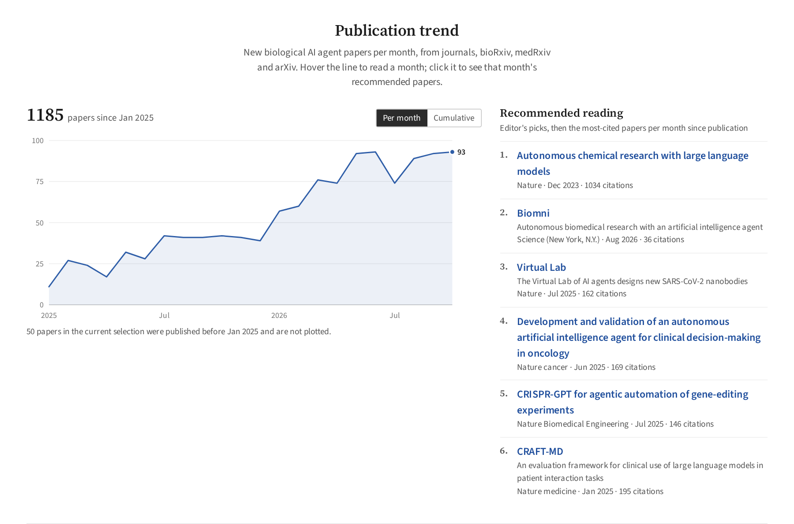
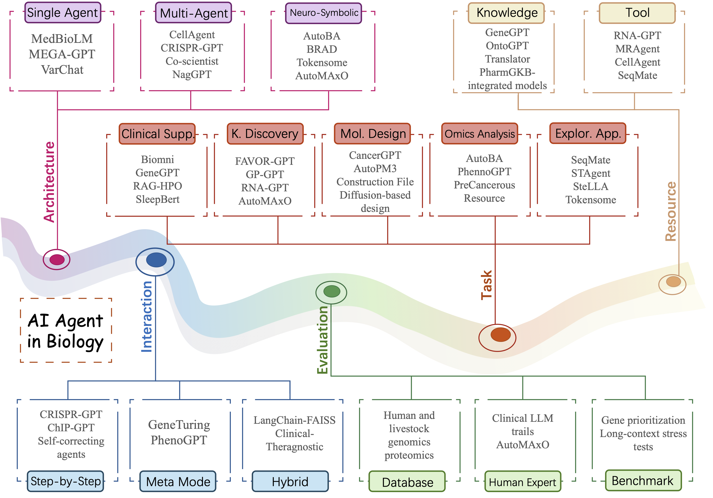

# AI Agents in Biology

<p align="center">
  <a href="https://mineself2016.github.io/biological_agents_survey/"></a>
</p>
<p align="center">
  <b><a href="https://mineself2016.github.io/biological_agents_survey/">Open the project page →</a></b><br>
  <sub>Filter all 1280 papers by the five taxonomy dimensions, follow the monthly trend, and find recommended reading.</sub>
</p>

[](#all-papers)
[](#latest-papers)
[](https://mineself2016.github.io/biological_agents_survey/)

Companion resource for

> **[Artificial Intelligence agents for biological research: a survey](https://academic.oup.com/bib/article/27/1/bbag075/8499367)**
> Cong Qi\*, Wenbo Wang\*, Siqi Jiang, Qin Liu, Xun Song, Hanzhang Fang, Zhi Wei.
> *Briefings in Bioinformatics* 27(1), bbag075 (2026).

A curated, weekly updated list of LLM-driven AI agents for biological and biomedical research,
from journals, bioRxiv, medRxiv and arXiv. Every paper is tagged on the survey's five dimensions:
biological task, system architecture, interaction mode, evaluation strategy and resource integration.
**[Browse it on the project page](https://mineself2016.github.io/biological_agents_survey/)** to filter by any combination of tags and see
how the field grows month by month.



## Recommended reading

Most-cited papers per month since publication (citation counts from OpenAlex).

- [Autonomous chemical research with large language models](https://www.nature.com/articles/s41586-023-06792-0) † · Dec 2023 · *Nature* `Molecular & drug design` `Multi-agent` `Step-by-step` `Automated, model-centric` `Tool-augmented` `Knowledge-augmented` · 1050 citations
- **Biomni**: [Autonomous biomedical research with an artificial intelligence agent](https://doi.org/10.1126/science.adz4351) · Aug 2026 · *Science (New York, N.Y.)* `Knowledge discovery & hypothesis generation` `Multi-omics analysis` `Molecular & drug design` `Exploratory applications` `Single-agent` `Step-by-step` `Automated, model-centric` `Knowledge-augmented` `Tool-augmented` · 39 citations
- **Virtual Lab**: [The Virtual Lab of AI agents designs new SARS-CoV-2 nanobodies](https://doi.org/10.1038/s41586-025-09442-9) · Jul 2025 · *Nature* `Molecular & drug design` `Multi-agent` `Step-by-step` `Automated, model-centric` `Human-in-the-loop` `Tool-augmented` · 167 citations
- [Development and validation of an autonomous artificial intelligence agent for clinical decision-making in oncology](https://doi.org/10.1038/s43018-025-00991-6) · Jun 2025 · *Nature cancer* `Clinical decision support` `Single-agent` `Step-by-step` `Automated, model-centric` `Human-in-the-loop` `Knowledge-augmented` `Tool-augmented` · 173 citations
- **CRAFT-MD**: [An evaluation framework for clinical use of large language models in patient interaction tasks](https://doi.org/10.1038/s41591-024-03328-5) · Jan 2025 · *Nature medicine* `Clinical decision support` `Step-by-step` `Zero-shot planner` `Automated, model-centric` `Human-in-the-loop` `Knowledge-augmented` `Tool-augmented` · 201 citations
- [CRISPR-GPT for agentic automation of gene-editing experiments](https://www.nature.com/articles/s41551-025-01463-z) † · Jul 2025 · *Nature Biomedical Engineering* `Knowledge discovery & hypothesis generation` `Molecular & drug design` `Multi-agent` `Step-by-step` `Hybrid` `Automated, model-centric` `Human-in-the-loop` `Tool-augmented` `Knowledge-augmented` · 146 citations
- [Leveraging Large Language Models for Decision Support in Personalized Oncology](https://jamanetwork.com/journals/jamanetworkopen/fullarticle/2812097#google_vignette) † · Nov 2023 · *JAMA Network Open* `Clinical decision support` `Single-agent` `Zero-shot planner` `Human-in-the-loop` · 306 citations
- **Co-Scientist**: [Accelerating scientific discovery with Co-Scientist](https://arxiv.org/abs/2502.18864) · Feb 2025 · *arXiv* `Knowledge discovery & hypothesis generation` `Molecular & drug design` `Multi-agent` `Step-by-step` `Automated, model-centric` `Human-in-the-loop` `Knowledge-augmented` · 158 citations
- **DeepRare**: [An agentic system for rare disease diagnosis with traceable reasoning](https://doi.org/10.1038/s41586-025-10097-9) · Feb 2026 · *Nature* `Clinical decision support` `Multi-agent` `Step-by-step` `Automated, model-centric` `Human-in-the-loop` `Knowledge-augmented` `Tool-augmented` · 62 citations
- [Biomni: A General-Purpose Biomedical AI Agent](https://pmc.ncbi.nlm.nih.gov/articles/PMC12157518/) † · Jun 2025 · *bioRxiv* `Clinical decision support` `Knowledge discovery & hypothesis generation` `Molecular & drug design` `Multi-omics analysis` `Single-agent` `Step-by-step` `Automated, model-centric` `Tool-augmented` `Knowledge-augmented` · 124 citations
- **MIRA**: [Towards autonomous medical artificial intelligence agents](https://doi.org/10.1038/s41586-026-10675-5) · Jun 2026 · *Nature* `Clinical decision support` `Single-agent` `Step-by-step` `Automated, model-centric` `Human-in-the-loop` `Tool-augmented` · 31 citations
- **MAC**: [Enhancing diagnostic capability with multi-agents conversational large language models](https://doi.org/10.1038/s41746-025-01550-0) · Mar 2025 · *NPJ digital medicine* `Clinical decision support` `Multi-agent` `Step-by-step` `Automated, model-centric` `Human-in-the-loop` `Knowledge-augmented` · 119 citations
- [GeneGPT: Augmenting Large Language Models with Domain Tools for Improved Access to Biomedical Information](https://academic.oup.com/bioinformatics/article/40/2/btae075/7606338) † · Feb 2024 · *Bioinformatics* `Clinical decision support` `Knowledge discovery & hypothesis generation` `Single-agent` `Step-by-step` `Automated, model-centric` `Tool-augmented` · 176 citations
- **GeneAgent**: [GeneAgent: self-verification language agent for gene-set analysis using domain databases](https://doi.org/10.1038/s41592-025-02748-6) · Jul 2025 · *Nature methods* `Knowledge discovery & hypothesis generation` `Single-agent` `Step-by-step` `Human-in-the-loop` `Automated, model-centric` `Knowledge-augmented` · 65 citations
- **CellVoyager**: [CellVoyager: AI CompBio agent generates new insights by autonomously analyzing biological data](https://doi.org/10.1038/s41592-026-03029-6) · Mar 2026 · *Nature methods* `Multi-omics analysis` `Knowledge discovery & hypothesis generation` `Single-agent` `Step-by-step` `Automated, model-centric` `Human-in-the-loop` `Tool-augmented` · 32 citations

## Latest papers

- [Evaluating large language models versus human therapists in generating interventions for patients with depression in psychodynamic psychotherapy. ](https://doi.org/10.1037/ccp0001034) · Oct 2026 · *Journal of consulting and clinical psychology* `Clinical decision support` `Multi-agent` `Neuro-symbolic` `Zero-shot planner` `Human-in-the-loop` `Knowledge-augmented`
- [Using iterative agentic retrieval-augmented generation to refine the risk of infection from social contexts during the COVID-19 pandemic: Development and Evaluation Study](https://doi.org/10.64898/2026.10.28.26366693) · Oct 2026 · *medRxiv* `Clinical decision support` `Knowledge discovery & hypothesis generation` `Single-agent` `Step-by-step` `Automated, model-centric` `Knowledge-augmented`
- **SMART**: [Agentic Discovery Transfer Enables Cross-Cancer Discovery at Scale](https://doi.org/10.64898/2026.10.28.762506) · Oct 2026 · *bioRxiv* `Knowledge discovery & hypothesis generation` `Molecular & drug design` `Multi-agent` `Step-by-step` `Human-in-the-loop` `Knowledge-augmented` `Tool-augmented`
- [An agentic AI system enhances clinical detection of immune-related adverse events in a multi-phase validation study. ](https://doi.org/10.1038/s43018-026-01264-6) · Oct 2026 · *Nature cancer* `Clinical decision support` `Single-agent` `Step-by-step` `Automated, model-centric` `Human-in-the-loop` `Knowledge-augmented`
- **PharmaAgent**: [PharmaAgent: a real-world evaluation of high- and low-autonomy agentic systems for inpatient vancomycin dosing](https://doi.org/10.64898/2026.10.23.26365968) · Oct 2026 · *medRxiv* `Clinical decision support` `Single-agent` `Step-by-step` `Hybrid` `Automated, model-centric` `Human-in-the-loop` `Knowledge-augmented`
- **AI agent framework**: [Lineage-mixed neurodevelopmental programs in pediatric sarcomas nominate tumor-selective surface antigen pairs](https://doi.org/10.64898/2026.10.28.762504) · Oct 2026 · *bioRxiv* `Knowledge discovery & hypothesis generation` `Molecular & drug design` `Single-agent` `Zero-shot planner` `Human-in-the-loop` `Knowledge-augmented`
- **ClinGeX**: [Advancing Clinical Genomic Analysis with a Skill-Centred Agent](https://arxiv.org/abs/2610.40556) · Oct 2026 · *arXiv* `Clinical decision support` `Knowledge discovery & hypothesis generation` `Single-agent` `Hybrid` `Human-in-the-loop` `Knowledge-augmented` `Tool-augmented`
- **CEDAR**: [Agentic LLM reasoning in pediatric diabetes outcome prediction from multimodal medical records](https://arxiv.org/abs/2610.40379) · Oct 2026 · *arXiv* `Clinical decision support` `Knowledge discovery & hypothesis generation` `Single-agent` `Step-by-step` `Automated, model-centric` `Human-in-the-loop` `Knowledge-augmented`
- **EpidemIA**: [Can AI Agents Interface Clinicians and Complex Models?](https://arxiv.org/abs/2610.39681) · Oct 2026 · *arXiv* `Clinical decision support` `Knowledge discovery & hypothesis generation` `Multi-agent` `Step-by-step` `Human-in-the-loop` `Knowledge-augmented` `Tool-augmented`
- **MoLRSI**: [MoLRSI: A Recursive Self-Improving AI agent for Molecular Discovery](https://arxiv.org/abs/2610.39714) · Oct 2026 · *arXiv* `Molecular & drug design` `Knowledge discovery & hypothesis generation` `Single-agent` `Step-by-step` `Human-in-the-loop` `Knowledge-augmented` `Tool-augmented`
- **Claude Opus 5.5**: [The Generalist Strikes Back:\\A General LLM Agent Outperforms Specialist Bioinformatics Agents on Free-Form, End-to-End Benchmark Analysis](https://doi.org/10.21203/rs.3.rs-11485353/v1) · Oct 2026 · *Research Square* `Knowledge discovery & hypothesis generation` `Exploratory applications` `Single-agent` `Zero-shot planner` `Automated, model-centric` `Tool-augmented`
- **Reliability Gateway**: [A Step-Level Reliability Gateway for Agentic Clinical Decision Support: Architecture and Edge Deployment](https://doi.org/10.20944/preprints202610.2846.v1) · Oct 2026 · *Preprints.org* `Clinical decision support` `Single-agent` `Step-by-step` `Automated, model-centric`
- [Asking the Data: Conversational Interrogation of LC–MS/MS Proteomics Data Sets with an LLM Agent](https://doi.org/10.64898/2026.10.22.760949) · Oct 2026 · *bioRxiv* `Knowledge discovery & hypothesis generation` `Exploratory applications` `Single-agent` `Step-by-step` `Human-in-the-loop` `Knowledge-augmented` `Tool-augmented`
- [Evaluating and improving AI agents for sequencing protocol understanding](https://arxiv.org/abs/2610.37851) · Oct 2026 · *arXiv* `Knowledge discovery & hypothesis generation` `Single-agent` `Zero-shot planner` `Automated, model-centric` `Human-in-the-loop` `Knowledge-augmented`
- [M4Bench: Evaluating Procedural Specification for Clinical EHR Derivation Agents](https://arxiv.org/abs/2610.37459) · Oct 2026 · *arXiv* `Clinical decision support` `Knowledge discovery & hypothesis generation` `Single-agent` `Zero-shot planner` `Automated, model-centric` `Knowledge-augmented`
- **OpenGray**: [OpenGray: a benchmark for evaluating the decisions of radiotherapy planning agents](https://arxiv.org/abs/2610.37081) · Oct 2026 · *arXiv* `Clinical decision support` `Single-agent` `Step-by-step` `Human-in-the-loop` `Automated, model-centric` `Knowledge-augmented`
- **DeepMAST**: [An evidence-governed agent harness for spatial transcriptomics prioritizes ICAM-1 as a target in lung fibrosis](https://doi.org/10.64898/2026.10.22.760550) · Oct 2026 · *bioRxiv* `Knowledge discovery & hypothesis generation` `Molecular & drug design` `Multi-agent` `Hybrid` `Automated, model-centric` `Human-in-the-loop` `Knowledge-augmented` `Tool-augmented`
- [Autonomous Structural Discovery Of Bioprocess Dynamics And Kinetics Via LLM-Driven Agents](https://arxiv.org/abs/2610.35391) · Oct 2026 · *arXiv* `Knowledge discovery & hypothesis generation` `Single-agent` `Neuro-symbolic` `Step-by-step` `Automated, model-centric` `Knowledge-augmented` `Tool-augmented`
- [Ontology-guided multi-agent reasoning for explainable differential diagnosis](https://arxiv.org/abs/2610.36325) · Oct 2026 · *arXiv* `Clinical decision support` `Knowledge discovery & hypothesis generation` `Multi-agent` `Step-by-step` `Human-in-the-loop` `Knowledge-augmented`
- **CohortFlow**: [CohortFlow: A Steerable Clinical Cohort Curation Agent with Localized Semantic Correction](https://arxiv.org/abs/2610.36100) · Oct 2026 · *arXiv* `Clinical decision support` `Single-agent` `Step-by-step` `Automated, model-centric` `Human-in-the-loop` `Knowledge-augmented`

See the [2026 list](papers/2026.md) for more.

## Where the field is

Counts across all 1280 papers; a paper can sit in more than one cell.

**Task × architecture**

| Task \ System architecture | Single-agent | Multi-agent | Neuro-symbolic |
|---|---|---|---|
| Clinical decision support | 389 | 386 | 91 |
| Knowledge discovery & hypothesis generation | 342 | 235 | 51 |
| Molecular & drug design | 121 | 82 | 28 |
| Multi-omics analysis | 102 | 59 | 14 |
| Exploratory applications | 87 | 51 | 4 |

**Task × resource integration**

| Task \ Resource integration | Knowledge-augmented | Tool-augmented |
|---|---|---|
| Clinical decision support | 538 | 333 |
| Knowledge discovery & hypothesis generation | 473 | 334 |
| Molecular & drug design | 150 | 152 |
| Multi-omics analysis | 101 | 128 |
| Exploratory applications | 73 | 92 |

## All papers

Grouped by year, then by biological task: [2026](papers/2026.md) (845) · [2025](papers/2025.md) (391) · [Earlier](papers/earlier.md) (44).

Benchmarks, agent libraries, knowledge sources and bioinformatics tools are listed in [resources.md](resources.md).

## Contributing

Missing a paper? Open an issue with the **Add a paper** template, or send a pull request that
appends an entry to [`data/papers.yaml`](data/papers.yaml):

```yaml
- id: shortname-2026            # unique, lowercase
  name: ShortName               # optional
  title: "Full paper title"
  url: https://doi.org/...
  date: 2026-05-14
  year: 2026
  venue: Nature Methods
  code: https://github.com/...   # optional
  summary: Two or three sentences on what the system does.
  task: [multi-omics]
  architecture: [multi-agent]
  interaction: [step-by-step]
  evaluation: [automated]
  resources: [tool-augmented]
```

Allowed tag values are listed in [`data/taxonomy.yaml`](data/taxonomy.yaml).
`python scripts/build.py` validates the data and regenerates this README, the year pages and the project page data.

## Citation

```bibtex
@article{qi2026artificial,
  title={Artificial Intelligence agents for biological research: a survey},
  author={Qi, Cong and Wang, Wenbo and Jiang, Siqi and Liu, Qin and Song, Xun and Fang, Hanzhang and Wei, Zhi},
  journal={Briefings in Bioinformatics},
  volume={27},
  number={1},
  pages={bbag075},
  year={2026},
  publisher={Oxford University Press}
}
```
