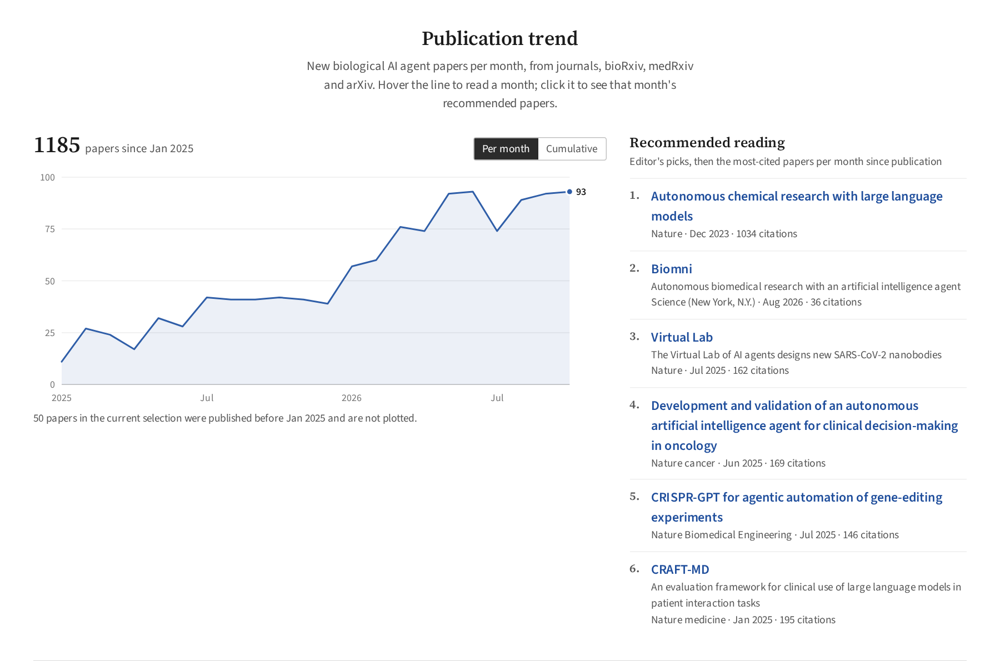

# AI Agents in Biology

<p align="center">
  <a href="https://mineself2016.github.io/biological_agents_survey/"></a>
</p>
<p align="center">
  <b><a href="https://mineself2016.github.io/biological_agents_survey/">Open the project page →</a></b><br>
  <sub>Filter all 1235 papers by the five taxonomy dimensions, follow the monthly trend, and find recommended reading.</sub>
</p>

[](#all-papers)
[](#latest-papers)
[](https://mineself2016.github.io/biological_agents_survey/)

Companion resource for

> **[Artificial Intelligence agents for biological research: a survey](https://academic.oup.com/bib/article/27/1/bbag075/8499367)**
> Cong Qi\*, Wenbo Wang\*, Siqi Jiang, Qin Liu, Xun Song, Hanzhang Fang, Zhi Wei.
> *Briefings in Bioinformatics* 27(1), bbag075 (2026).

A curated, weekly updated list of LLM-driven AI agents for biological and biomedical research,
from journals, bioRxiv, medRxiv and arXiv. Every paper is tagged on the survey's five dimensions:
biological task, system architecture, interaction mode, evaluation strategy and resource integration.
**[Browse it on the project page](https://mineself2016.github.io/biological_agents_survey/)** to filter by any combination of tags and see
how the field grows month by month.


## Recommended reading

Most-cited papers per month since publication (citation counts from OpenAlex).

- [Autonomous chemical research with large language models](https://www.nature.com/articles/s41586-023-06792-0) † · Dec 2023 · *Nature* `Molecular & drug design` `Multi-agent` `Step-by-step` `Automated, model-centric` `Tool-augmented` `Knowledge-augmented` · 1034 citations
- **Biomni**: [Autonomous biomedical research with an artificial intelligence agent](https://doi.org/10.1126/science.adz4351) · Aug 2026 · *Science (New York, N.Y.)* `Knowledge discovery & hypothesis generation` `Multi-omics analysis` `Molecular & drug design` `Exploratory applications` `Single-agent` `Step-by-step` `Automated, model-centric` `Knowledge-augmented` `Tool-augmented` · 36 citations
- **Virtual Lab**: [The Virtual Lab of AI agents designs new SARS-CoV-2 nanobodies](https://doi.org/10.1038/s41586-025-09442-9) · Jul 2025 · *Nature* `Molecular & drug design` `Multi-agent` `Step-by-step` `Automated, model-centric` `Human-in-the-loop` `Tool-augmented` · 162 citations
- [Development and validation of an autonomous artificial intelligence agent for clinical decision-making in oncology](https://doi.org/10.1038/s43018-025-00991-6) · Jun 2025 · *Nature cancer* `Clinical decision support` `Single-agent` `Step-by-step` `Automated, model-centric` `Human-in-the-loop` `Knowledge-augmented` `Tool-augmented` · 169 citations
- [CRISPR-GPT for agentic automation of gene-editing experiments](https://www.nature.com/articles/s41551-025-01463-z) † · Jul 2025 · *Nature Biomedical Engineering* `Knowledge discovery & hypothesis generation` `Molecular & drug design` `Multi-agent` `Step-by-step` `Hybrid` `Automated, model-centric` `Human-in-the-loop` `Tool-augmented` `Knowledge-augmented` · 146 citations
- **CRAFT-MD**: [An evaluation framework for clinical use of large language models in patient interaction tasks](https://doi.org/10.1038/s41591-024-03328-5) · Jan 2025 · *Nature medicine* `Clinical decision support` `Step-by-step` `Zero-shot planner` `Automated, model-centric` `Human-in-the-loop` `Knowledge-augmented` `Tool-augmented` · 195 citations
- [Leveraging Large Language Models for Decision Support in Personalized Oncology](https://jamanetwork.com/journals/jamanetworkopen/fullarticle/2812097#google_vignette) † · Nov 2023 · *JAMA Network Open* `Clinical decision support` `Single-agent` `Zero-shot planner` `Human-in-the-loop` · 302 citations
- [Biomni: A General-Purpose Biomedical AI Agent](https://pmc.ncbi.nlm.nih.gov/articles/PMC12157518/) † · Jun 2025 · *bioRxiv* `Clinical decision support` `Knowledge discovery & hypothesis generation` `Molecular & drug design` `Multi-omics analysis` `Single-agent` `Step-by-step` `Automated, model-centric` `Tool-augmented` `Knowledge-augmented` · 124 citations
- **Co-Scientist**: [Accelerating scientific discovery with Co-Scientist](https://arxiv.org/abs/2502.18864) · Feb 2025 · *arXiv* `Knowledge discovery & hypothesis generation` `Molecular & drug design` `Multi-agent` `Step-by-step` `Automated, model-centric` `Human-in-the-loop` `Knowledge-augmented` · 153 citations
- **DeepRare**: [An agentic system for rare disease diagnosis with traceable reasoning](https://doi.org/10.1038/s41586-025-10097-9) · Feb 2026 · *Nature* `Clinical decision support` `Multi-agent` `Step-by-step` `Automated, model-centric` `Human-in-the-loop` `Knowledge-augmented` `Tool-augmented` · 60 citations
- **MIRA**: [Towards autonomous medical artificial intelligence agents](https://doi.org/10.1038/s41586-026-10675-5) · Jun 2026 · *Nature* `Clinical decision support` `Single-agent` `Step-by-step` `Automated, model-centric` `Human-in-the-loop` `Tool-augmented` · 30 citations
- **MAC**: [Enhancing diagnostic capability with multi-agents conversational large language models](https://doi.org/10.1038/s41746-025-01550-0) · Mar 2025 · *NPJ digital medicine* `Clinical decision support` `Multi-agent` `Step-by-step` `Automated, model-centric` `Human-in-the-loop` `Knowledge-augmented` · 119 citations
- [GeneGPT: Augmenting Large Language Models with Domain Tools for Improved Access to Biomedical Information](https://academic.oup.com/bioinformatics/article/40/2/btae075/7606338) † · Feb 2024 · *Bioinformatics* `Clinical decision support` `Knowledge discovery & hypothesis generation` `Single-agent` `Step-by-step` `Automated, model-centric` `Tool-augmented` · 175 citations
- **GeneAgent**: [GeneAgent: self-verification language agent for gene-set analysis using domain databases](https://doi.org/10.1038/s41592-025-02748-6) · Jul 2025 · *Nature methods* `Knowledge discovery & hypothesis generation` `Single-agent` `Step-by-step` `Human-in-the-loop` `Automated, model-centric` `Knowledge-augmented` · 65 citations
- **CellVoyager**: [CellVoyager: AI CompBio agent generates new insights by autonomously analyzing biological data](https://doi.org/10.1038/s41592-026-03029-6) · Mar 2026 · *Nature methods* `Multi-omics analysis` `Knowledge discovery & hypothesis generation` `Single-agent` `Step-by-step` `Automated, model-centric` `Human-in-the-loop` `Tool-augmented` · 31 citations

## Latest papers

- [Real PMIDs, Wrong Papers: Harness Design for Biomedical Claim-Verification Agents](https://arxiv.org/abs/2610.29812) · Oct 2026 · *arXiv* `Knowledge discovery & hypothesis generation` `Single-agent` `Step-by-step` `Zero-shot planner` `Human-in-the-loop` `Knowledge-augmented`
- [An Evidence-Driven Multi-Agent Compound AI System for Head and Neck Proton Radiotherapy Planning](https://arxiv.org/abs/2610.29010) · Oct 2026 · *arXiv* `Clinical decision support` `Multi-agent` `Step-by-step` `Hybrid` `Automated, model-centric` `Knowledge-augmented` `Tool-augmented`
- [Agentic artificial intelligence for code status extraction from clinical notes: a cross-model comparison of single agent, reflective agent, and multiagent extractor-reviewer system](https://doi.org/10.1093/jamia/ocag179) · Oct 2026 · *Journal of the American Medical Informatics Association : JAMIA* `Clinical decision support` `Single-agent` `Multi-agent` `Neuro-symbolic` `Step-by-step` `Automated, model-centric`
- [Workflow Topology-Guided Skill Loading for Agentic AI in Clinical Trial Data Pipelines: Sequential Exploratory Evaluation](https://doi.org/10.2196/100769) · Oct 2026 · *JMIR formative research* `Knowledge discovery & hypothesis generation` `Single-agent` `Step-by-step` `Automated, model-centric` `Human-in-the-loop` `Knowledge-augmented`
- **Pathways**: [An Auditable AI Pipeline for Long-Tail Healthcare Resource Discovery and Directory Maintenance](https://doi.org/10.20944/preprints202610.1985.v1) · Oct 2026 · *Preprints.org* `Knowledge discovery & hypothesis generation` `Single-agent` `Hybrid` `Automated, model-centric` `Human-in-the-loop` `Knowledge-augmented`
- **ColonyAgent**: [Knowledge-Guided Skills Agent for Microbial Colony Detection in Automated Laboratory Testing](https://doi.org/10.1109/jbhi.2026.3745622) · Oct 2026 · *IEEE journal of biomedical and health informatics* `Exploratory applications` `Single-agent` `Step-by-step` `Automated, model-centric` `Knowledge-augmented` `Tool-augmented`
- **NeuroPilot**: [NeuroPilot: Longitudinal intravital neural imaging across scales and modalities through an agentic platform](https://doi.org/10.64898/2026.10.18.759043) · Oct 2026 · *bioRxiv* `Knowledge discovery & hypothesis generation` `Exploratory applications` `Single-agent` `Step-by-step` `Human-in-the-loop` `Tool-augmented`
- [The accessible human surfaceome](https://doi.org/10.64898/2026.10.18.759859) · Oct 2026 · *bioRxiv* `Knowledge discovery & hypothesis generation` `Single-agent` `Step-by-step` `Automated, model-centric` `Human-in-the-loop` `Knowledge-augmented`
- **EchoMed Agent**: [EchoMed Agent: A Foundation Model–Based Agentic Framework for Echocardiographic Left Ventricular Segmentation and Functional Assessment](https://doi.org/10.21203/rs.3.rs-11209308/v1) · Oct 2026 · *Research Square* `Clinical decision support` `Single-agent` `Step-by-step` `Automated, model-centric` `Tool-augmented`
- **PigGPA**: [PigGPA: A Domain-Constrained Agent for Porcine Genomic Breeding with Verifiable Tool Execution](https://doi.org/10.64898/2026.10.18.759908) · Oct 2026 · *bioRxiv* `Multi-omics analysis` `Single-agent` `Neuro-symbolic` `Step-by-step` `Automated, model-centric` `Tool-augmented`
- **MedMCP**: [MedMCP: An Open Agentic Ecosystem for Medical Imaging Workflows](https://doi.org/10.64898/2026.10.12.758708) · Oct 2026 · *bioRxiv* `Clinical decision support` `Knowledge discovery & hypothesis generation` `Single-agent` `Step-by-step` `Human-in-the-loop` `Knowledge-augmented` `Tool-augmented`
- **Magnolia**: [Magnolia: A Persistent-Memory Agent Framework for Computational Chemistry](https://arxiv.org/abs/2610.27230) · Oct 2026 · *arXiv* `Molecular & drug design` `Exploratory applications` `Single-agent` `Step-by-step` `Hybrid` `Automated, model-centric` `Tool-augmented`
- **CS1**: [A general-purpose System One decision model for clinical records](https://arxiv.org/abs/2610.27099) · Oct 2026 · *arXiv* `Clinical decision support` `Single-agent` `Step-by-step` `Automated, model-centric` `Tool-augmented`
- [Does Multi-Agent Collaboration Reduce Hallucination in Clinical Tasks?](https://arxiv.org/abs/2610.27027) · Oct 2026 · *arXiv* `Clinical decision support` `Multi-agent` `Single-agent` `Human-in-the-loop`
- **LeakBench**: [LeakBench: Auditing Reward Hacking through Prediction-Time Leakage in Clinical Modeling Agents](https://arxiv.org/abs/2610.26088) · Oct 2026 · *arXiv* `Clinical decision support` `Human-in-the-loop` `Automated, model-centric` `Knowledge-augmented`
- **PRAXIS-MD**: [PRAXIS-MD: a long-term brain-enhanced agent framework for end-to-end molecular dynamics research](https://doi.org/10.1016/j.jmgm.2026.109623) · Oct 2026 · *Journal of molecular graphics & modelling* `Molecular & drug design` `Knowledge discovery & hypothesis generation` `Single-agent` `Step-by-step` `Automated, model-centric` `Knowledge-augmented`
- [Aptamers as a sandbox for lab-in-the-loop agentic molecular discovery](https://arxiv.org/abs/2610.24806) · Oct 2026 · *arXiv* `Molecular & drug design` `Exploratory applications` `Single-agent` `Step-by-step` `Human-in-the-loop` `Knowledge-augmented` `Tool-augmented`
- **CADS**: [CADS: Measuring the Incremental Contribution of LLM Proposers in Sequential Biological Screens](https://arxiv.org/abs/2610.24597) · Oct 2026 · *arXiv* `Knowledge discovery & hypothesis generation` `Single-agent` `Step-by-step` `Automated, model-centric` `Human-in-the-loop` `Knowledge-augmented`
- **EGIP**: [EGIP: An Evidence-Grounded Interaction Protocol for Clinical Agents](https://arxiv.org/abs/2610.24539) · Oct 2026 · *arXiv* `Clinical decision support` `Single-agent` `Step-by-step` `Automated, model-centric` `Human-in-the-loop` `Knowledge-augmented`
- **MedPAO-Assist**: [MedPAO-Assist: Edge-Deployable, Modality-Aware Agentic AI for Radiology Report Structuring](https://arxiv.org/abs/2610.26913) · Oct 2026 · *arXiv* `Clinical decision support` `Multi-agent` `Neuro-symbolic` `Step-by-step` `Automated, model-centric` `Knowledge-augmented`

See the [2026 list](papers/2026.md) for more.

## Where the field is

Counts across all 1235 papers; a paper can sit in more than one cell.

**Task × architecture**

| Task \ System architecture | Single-agent | Multi-agent | Neuro-symbolic |
|---|---|---|---|
| Clinical decision support | 374 | 376 | 90 |
| Knowledge discovery & hypothesis generation | 321 | 226 | 49 |
| Molecular & drug design | 112 | 79 | 27 |
| Multi-omics analysis | 101 | 59 | 14 |
| Exploratory applications | 83 | 51 | 4 |

**Task × resource integration**

| Task \ Resource integration | Knowledge-augmented | Tool-augmented |
|---|---|---|
| Clinical decision support | 515 | 325 |
| Knowledge discovery & hypothesis generation | 447 | 318 |
| Molecular & drug design | 138 | 143 |
| Multi-omics analysis | 100 | 127 |
| Exploratory applications | 71 | 90 |

## All papers

Grouped by year, then by biological task: [2026](papers/2026.md) (800) · [2025](papers/2025.md) (391) · [Earlier](papers/earlier.md) (44).

Benchmarks, agent libraries, knowledge sources and bioinformatics tools are listed in [resources.md](resources.md).

## Contributing

Missing a paper? Open an issue with the **Add a paper** template, or send a pull request that
appends an entry to [`data/papers.yaml`](data/papers.yaml):

```yaml
- id: shortname-2026            # unique, lowercase
  name: ShortName               # optional
  title: "Full paper title"
  url: https://doi.org/...
  date: 2026-05-14
  year: 2026
  venue: Nature Methods
  code: https://github.com/...   # optional
  summary: Two or three sentences on what the system does.
  task: [multi-omics]
  architecture: [multi-agent]
  interaction: [step-by-step]
  evaluation: [automated]
  resources: [tool-augmented]
```

Allowed tag values are listed in [`data/taxonomy.yaml`](data/taxonomy.yaml).
`python scripts/build.py` validates the data and regenerates this README, the year pages and the project page data.

## Citation

```bibtex
@article{qi2026artificial,
  title={Artificial Intelligence agents for biological research: a survey},
  author={Qi, Cong and Wang, Wenbo and Jiang, Siqi and Liu, Qin and Song, Xun and Fang, Hanzhang and Wei, Zhi},
  journal={Briefings in Bioinformatics},
  volume={27},
  number={1},
  pages={bbag075},
  year={2026},
  publisher={Oxford University Press}
}
```
